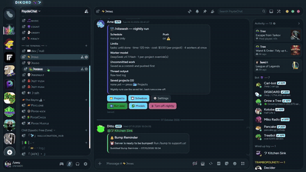
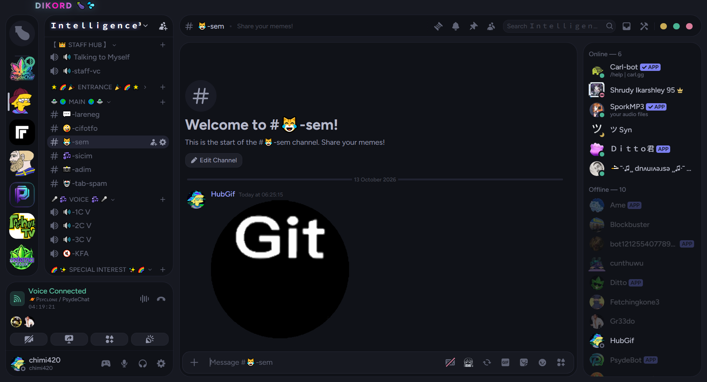
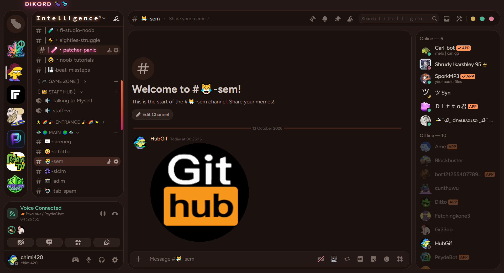
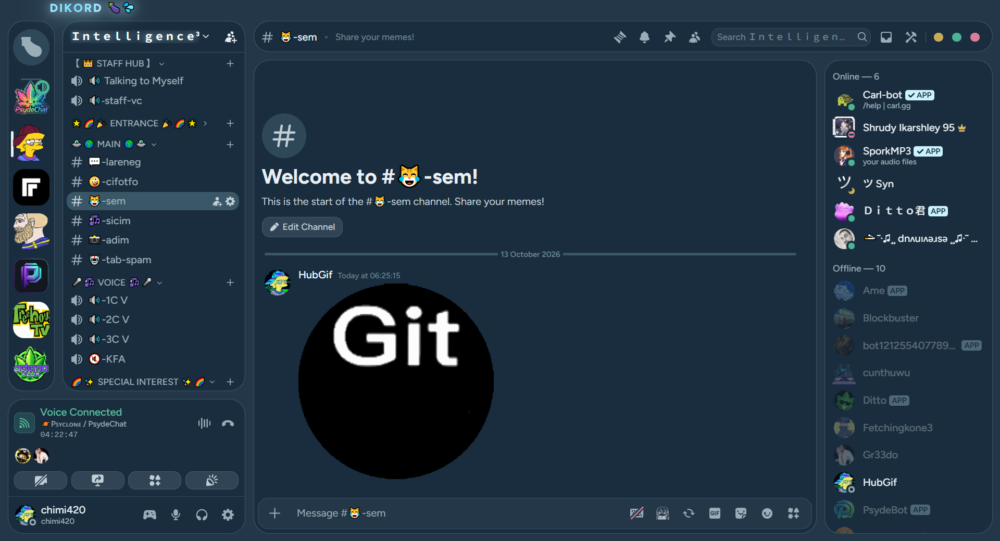
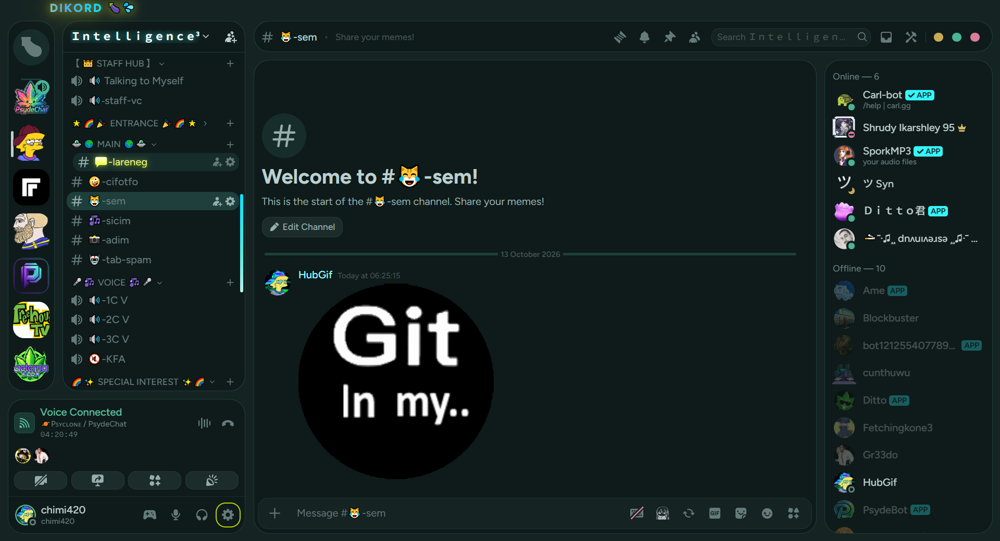
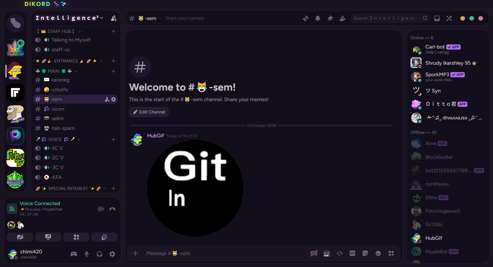

  

  
  

<i>17 discord themes. the avatars spin when you hover them in the actual app. that's the whole pitch.</i>

 
<b>spin on hover</b> — server icons spin on hover, new theme loads right in

real footage. real spinning. real hidden servers.

 

<a href="https://raw.githubusercontent.com/Chimthuwu/dikord-themes/main/DIKORD.theme.css"><b>DIKORD</b></a> ·
<a href="https://raw.githubusercontent.com/Chimthuwu/dikord-themes/main/DIKORD.theme%20-%20V2.css"><b>DIKORD V2</b></a> ·
<a href="https://raw.githubusercontent.com/Chimthuwu/dikord-themes/main/DIKORD.theme%20-%20V2%20-%20Chill.css"><b>DIKORD V2 Chill</b></a> ·
<a href="https://raw.githubusercontent.com/Chimthuwu/dikord-themes/main/DIKORD-Crimson.theme.css"><b>SATANCORD</b></a> ·
<a href="https://raw.githubusercontent.com/Chimthuwu/dikord-themes/main/DIKORD-Emerald.theme.css"><b>Emerald</b></a> ·
<a href="https://raw.githubusercontent.com/Chimthuwu/dikord-themes/main/DIKORD-Gold.theme.css"><b>Gold</b></a> ·
<a href="https://raw.githubusercontent.com/Chimthuwu/dikord-themes/main/DIKORD-Ice%20Blue.css"><b>Ice Blue</b></a> ·
<a href="https://raw.githubusercontent.com/Chimthuwu/dikord-themes/main/DIKORD%20IceBlue(Bright).css"><b>Ice Blue Bright</b></a> ·
<a href="https://raw.githubusercontent.com/Chimthuwu/dikord-themes/main/DIKORD-Frozen.css"><b>Frozen</b></a> ·
<a href="https://raw.githubusercontent.com/Chimthuwu/dikord-themes/main/DIKORD-Sunset.theme.css"><b>Sunset</b></a> ·
<a href="https://raw.githubusercontent.com/Chimthuwu/dikord-themes/main/DIKORD-Teal-Neon.theme.css"><b>Teal Cyan</b></a> ·
<a href="https://raw.githubusercontent.com/Chimthuwu/dikord-themes/main/DIKORD-Violet.theme.css"><b>Violet</b></a> ·
<a href="https://raw.githubusercontent.com/Chimthuwu/dikord-themes/main/DIKORD%20DELUXE.theme.css"><b>DELUXE</b></a> ·
<a href="https://raw.githubusercontent.com/Chimthuwu/dikord-themes/main/DIKORD-NITRO.theme.css"><b>NITRO</b></a> ·
<a href="https://raw.githubusercontent.com/Chimthuwu/dikord-themes/main/DIKORD-CatppuccinMocha.theme.css"><b>Catppuccin Mocha</b></a> ·
<a href="https://raw.githubusercontent.com/Chimthuwu/dikord-themes/main/DIKORD-CatppuccinMacchiato.theme.css"><b>Catppuccin Macchiato</b></a>

 

<h3 align="center">not mockups. real discord. real ugly channel names.</h3>

yes that's a github webhook avatar taking up the whole screen. no we're not cropping it out.

 <b>DIKORD</b>

 <b>SATANCORD</b>

 <b>Emerald</b>

 <b>Ice Blue</b>

 <b>Teal Cyan</b>

 <b>Violet</b>

 

  

raw hover reels (uncut, all themes back to back):

<a href="assets/raw/dikord-vid1.mp4">vid 1</a> ·
<a href="assets/raw/dikord-vid2.mp4">vid 2</a> ·
<a href="assets/raw/dikord-vid3.mp4">vid 3</a>

 

click a name to grab that theme's .css. throw it in your Vencord/Equicord themes folder. flip it on. spin stuff.

🍆💦

