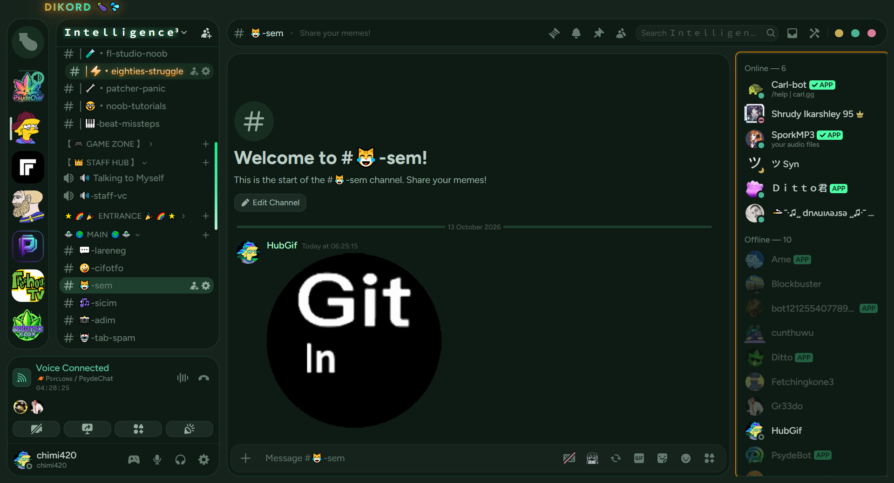
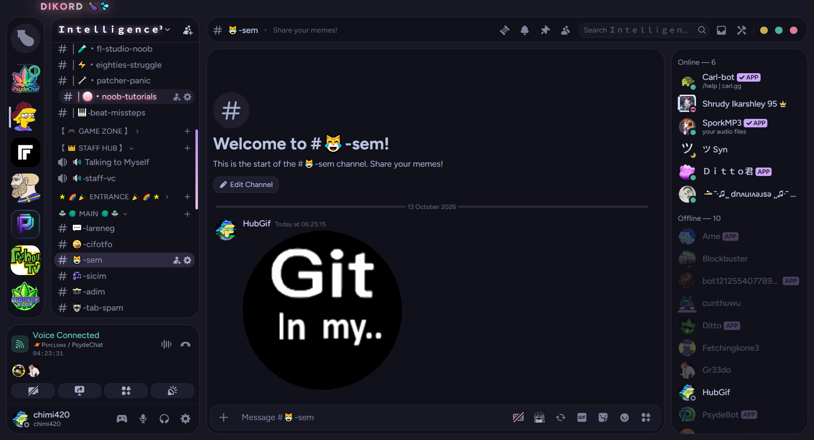
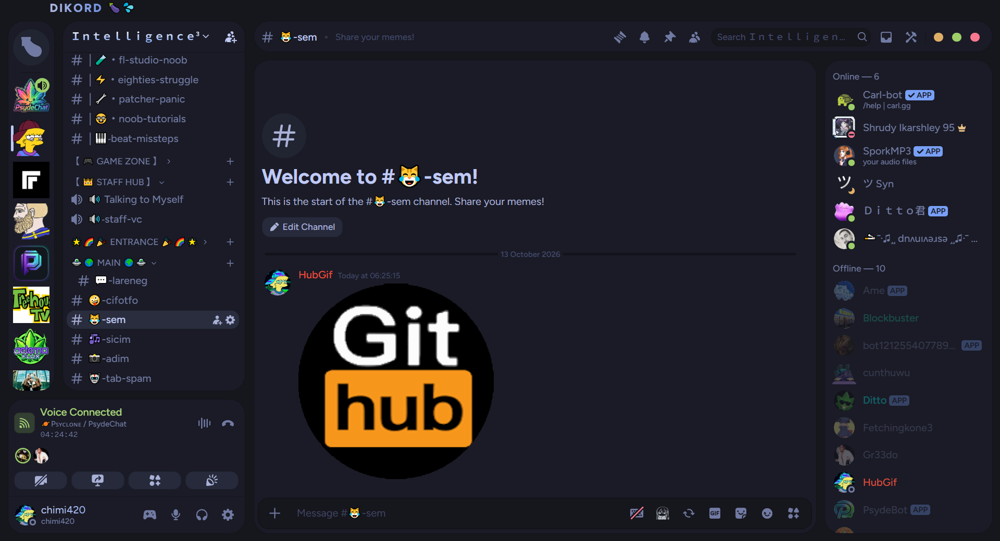

  

  
  
  

<i><b>17 Discord themes.</b> The avatars spin when you hover them. That's the whole pitch.</i>

---

## 📦 What's inside

| Theme | Vibe |
|---|---|
| **DIKORD** | the original. loud. unapologetic. |
| **DIKORD V2 / Violet** | same energy, purple problem |
| **Teal Cyan** | cool, calm, collected |
| **Emerald** | green machine |
| **Ice Blue** | subzero |
| **Gold** | expensive-looking |
| **Sunset** | warm gradients, warm feelings |
| **Catppuccin Mocha** | for the ricing crowd |
| **+ 9 more** | download the zip, you'll see |

Every theme includes **spin-on-hover** server icons. New theme loads in instantly. No restart.

---

## 🎬 See it move

   
  <b>spin on hover</b> — server icons spin, new theme loads right in

real footage. real spinning. real hidden servers.

---

## 🖼️ Not mockups. Real Discord. Real ugly channel names.

yes that's a GitHub webhook avatar taking up the whole screen. no we're not cropping it out.

   <b>DIKORD</b>

   <b>DIKORD V2 / Violet</b>

   <b>Teal Cyan</b>

   <b>Emerald</b>

   <b>Ice Blue</b>

   <b>Gold</b>

   <b>Sunset</b>

   <b>Catppuccin Mocha</b>

---

## 🛠️ Install

1. **Grab the zip** — [download all themes](https://github.com/Chimthuwu/dikord-themes/archive/refs/heads/main.zip)
2. **Drop the `.css`** you want into your Vencord/Equicord `themes` folder
   - `Vencord` → Settings → Themes → *Open Themes Folder*
3. **Flip it on.** Spin stuff. 🍆💦

  

---

made with spite, caffeine, and a spinning avatar obsession.

🍆💦

